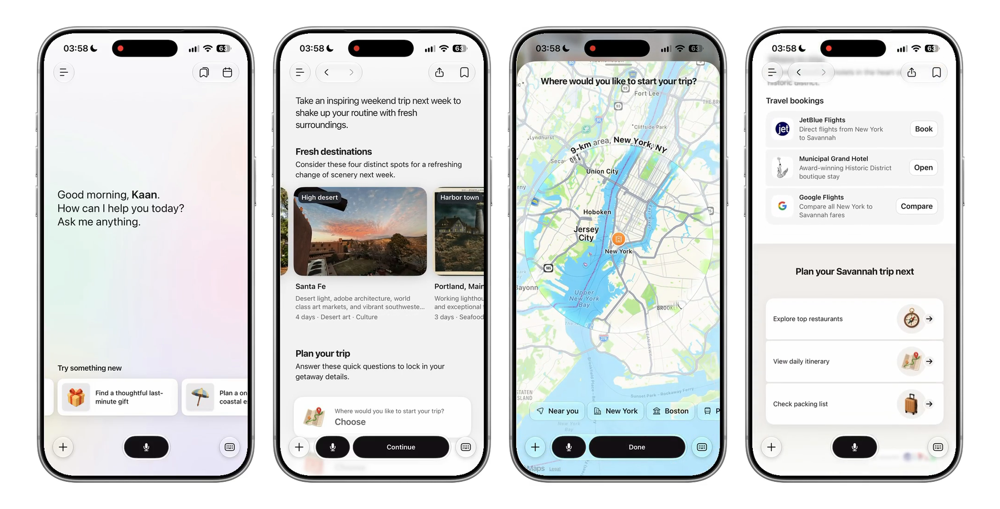
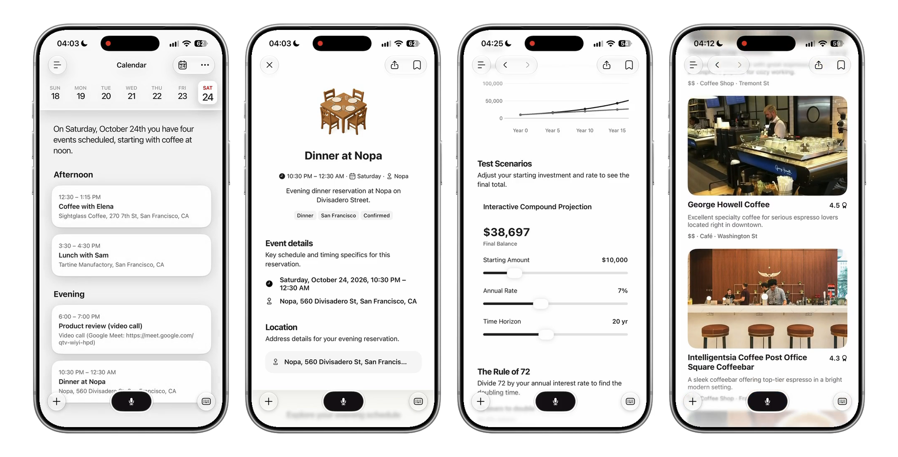

# Emblem

<p align="center">
  
</p>

<p align="center"><b>An open-source rebuild inspired by Monogram AI, in SwiftUI.</b></p>

Ask anything, and Emblem answers with a native iPhone page instead of a chat bubble. Trips become maps and day-by-day plans. Recipes become step cards. Choices become side-by-side comparisons. Your calendar becomes a day you can tap into.

## What it does

- **Generated pages.** Cards, carousels, maps, charts, comparisons, steps, quizzes and questions, streamed from the server and drawn natively in SwiftUI.
- **Question sheets.** When an answer needs more from you, it asks first with a sheet of choices.
- **Map lens.** Pick an area by moving the map under a Liquid Glass lens.
- **Calendar.** Swipe through your days. Every event opens into its own page.
- **Voice.** Hold the mic, and a glass wave rises while you speak.
- **Connectors.** Gmail and Google Calendar through Composio. Apple Calendar, Reminders and Apple Music on the phone.
- **Models.** Any OpenRouter model with tool calling and structured outputs (tested with Claude, Gemini, DeepSeek, Mistral and GPT-6 Luna), Cerebras, OpenAI, Google or Groq. Or Apple Intelligence on the phone.
- **3D object icons.** Generated with fal or Gemini, then cached.

<p align="center">
  
</p>

## How it works

1. You ask by voice or text.
2. If the request is open-ended, the server sends back a few questions first.
3. **Research.** The model calls tools: web search, places, weather, hotels and your connected apps.
4. **Compose.** A second call writes the page as typed JSON blocks and streams them to the phone.
5. SwiftUI renders each block the moment it arrives. Photos and icons load alongside.

The app is SwiftUI with an `EmblemCore` Swift package for models, streaming and networking. The server is Next.js with Convex for data, scheduled pages and rate limits. [`docs/architecture.md`](docs/architecture.md) goes deeper.

## Services

Only Convex and one model provider are required. Everything else turns on when you add its key to `server/.env.local`.

| Service | Used for |
| --- | --- |
| [Convex](https://convex.dev) | Database, scheduled pages, rate limits (required) |
| Cerebras, OpenAI, Google, Groq or OpenRouter | The model (one is required) |
| [Exa](https://exa.ai) | Web search and photos |
| [Clerk](https://clerk.com) | Sign-in (otherwise everyone is a guest) |
| [Composio](https://composio.dev) | Gmail and Google Calendar |
| [fal](https://fal.ai) or Gemini | Generated 3D object icons |
| [LiteAPI](https://liteapi.travel) | Hotel search |
| TMDB and OMDb | Movie and TV posters |
| xAI | Spoken answers |
| Open-Meteo and Wikipedia | Weather and photos (free, no key) |

On the phone, Emblem uses Apple Intelligence (on device or Private Cloud Compute), EventKit for Calendar and Reminders, Apple Music and MapKit.

## Run it

You need a Mac with Xcode 27, [XcodeGen](https://github.com/yonaskolb/XcodeGen), Node.js 22+ and a Cerebras or OpenAI API key.

**1. Start the server**

```sh
cd server
npm ci
cp .env.example .env.local
npx convex dev
```

Leave `convex dev` running. It creates a Convex deployment and writes its URL to `.env.local`. In a second terminal, still in `server/`, share a rate-limit secret with Convex:

```sh
SECRET=$(openssl rand -hex 32)
echo "RATE_LIMIT_SECRET=$SECRET" >> .env.local
npx convex env set RATE_LIMIT_SECRET "$SECRET"
```

Add your model key to `.env.local`: `CEREBRAS_API_KEY`, or `LLM_PROVIDER=openai` with `OPENAI_API_KEY`. Then start the API on port 3000:

```sh
npm run dev
```

**2. Run the app**

```sh
cd ios
./generate-project.sh
open Emblem.xcodeproj
```

Pick an iPhone simulator, press Run, tap **Continue as guest** and ask anything.

**3. On your iPhone (optional)**

Copy `ios/Local.xcconfig.example` to `ios/Local.xcconfig` and set `EMBLEM_SERVER_URL` to an address your phone can reach. Then:

```sh
EMBLEM_DEVICE_BUNDLE_ID=com.you.emblem ios/run-device.sh
```

[`server/README.md`](server/README.md) lists every key and model option.

## Contributing

`cd server && npm run check:fast` checks the server files you changed. `scripts/ios-check.sh` lints the Swift code, builds the app and runs the iOS tests. See [CONTRIBUTING.md](CONTRIBUTING.md).

## How it was built

Emblem was built with Claude Code and Codex. It is not affiliated with Monogram. Huge respect to the Monogram team.

## License

[AGPL-3.0](LICENSE). You can use, change and share Emblem, including commercially, as long as you release your full source under the same license. That also applies when you run a modified version as a hosted service or ship it in an app. Third-party notices are in [NOTICE](NOTICE).

The 3D object icons in my own build come from [Thiings](https://www.thiings.co), a licensed pack that is not included here. The build bundles it only when `EMBLEM_OBJECT_ASSET_DIR` points at a local copy. Without it, Emblem generates matching icons with fal or Gemini, and falls back to SF Symbols.

Dependencies keep their own licenses. `cd server && npm ls --omit=dev --all` lists the server's, and `ios/Package.resolved` pins the Swift packages.
