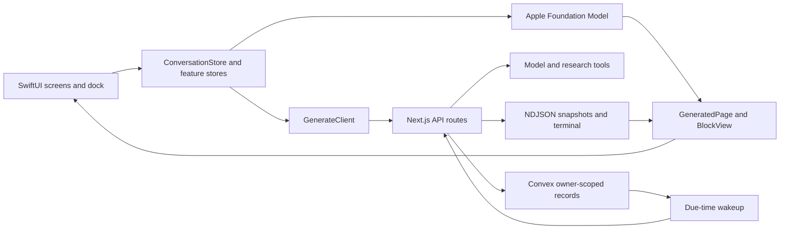

# Architecture

Emblem has one client, one API and one backend. SwiftUI owns presentation, local interaction and Apple model generation. Next.js owns server model calls, provider keys, research and response validation. Convex owns private records, generation leases and scheduled work. The app never talks to Convex directly.

## Screen-to-owner map

| Visible flow                                         | iOS owner                                                                         | API and durable work                                                      |
| ---------------------------------------------------- | --------------------------------------------------------------------------------- | ------------------------------------------------------------------------- |
| Onboarding, guest, sign-in, account deletion         | `AuthFlowView`, `AuthStore`                                                       | Clerk session, `/api/account`, `accounts.ts`                              |
| Home and recent conversations                        | `RootView`, `ConversationStore`, `ConversationHistory`                            | `/api/home`, `/api/conversations`, `conversations.ts`                     |
| Typed or spoken request and follow-up                | `DockView`, `ComposerCard`, `SpeechService`, `GenerationSession`, `GeneratedPage` | `/api/generate`; `generationRuns` and `pages` for signed-in users         |
| Cards, questions, charts, comparisons, maps, recipes | `Blocks`, `BlockView` and family views                                            | `schema.ts` block contract                                                |
| Editable writing                                     | `WritingBlockView`, `WritingClient`                                               | `/api/writing`                                                            |
| Apple model pages and model choice                   | `OnDeviceModel`, Apple Intelligence settings                                      | Optional public search through `/api/tools`                               |
| Card expansion and back/forward history              | `ConversationStore`, `PageExpansionSource`                                        | `/api/history`, cancellation and replay on `/api/generate`                |
| Rename, pin, archive, restore, delete conversation   | `ConversationsView`, `ArchivedChatsView`                                          | `/api/conversation`, `conversations.ts`                                   |
| Saved pages and items                                | `SavedPagesView`, `SavedPagesStore`, `SavedEntityDetailView`                      | Stored on device per account; `/api/saves/classify` picks the category    |
| Calendar day and week, event pages                   | `CalendarBrowserView`, `EventCardView`                                            | `/api/generate` with calendar context, `calendarEventDrillIn.ts`          |
| Question cards and choices                           | `QuestionListView`, `QuestionSheetHost`, `QuestionOptionsClient`                  | Suggested answers in the page; `/api/question-options` after it finishes  |
| Daily updates and automations                        | Settings, `ScheduledPagesView`, `AgentsStore`                                     | `/api/agents`, `automations.ts`, `automationDispatch.ts`, `background.ts` |
| Connected apps                                       | `ConnectorsView`, `ConnectedAppsStore`                                            | `/api/connectors`, Composio reads, `connectorPresentation.ts`             |
| Profile and memory                                   | `MemorySettingsView`, `MemoryStore`                                               | `/api/memory`, `profiles.ts`, `memories.ts`                               |
| Artwork, voice, quiz hints                           | `ImageLoader`, `VoiceOutput`, `QuizView`                                          | `/api/image`, `/api/generated-step-image`, `/api/tts`, `/api/hint`        |

## Generation

`GenerationSession` owns one run and its retry. `GenerationLifecycle` decides which status, completion, cancellation or replacement is allowed. Navigation owns where a page goes; the transport does not.

`GenerateClient` authenticates each request. `GenerationStream` decodes protocol lines into whole-page snapshots with increasing revisions. It rejects stale revisions, a terminal whose revision or block count disagrees with the last snapshot, and malformed lines. A stream that ends without a valid terminal is a retryable failure.

The server researches, composes a complete page, validates it, grounds it in what research returned, resolves artwork and persists the result. Then it emits the final snapshot and terminal. Status events and provisional `pagePreview` events stream earlier.

Saved history and automation results decode through the same `Block` decoder. Unknown or malformed blocks are skipped; valid neighbours still render.

Apple model generation uses its own typed snapshot adapter and the same client lifecycle. It never falls back to the server silently. The client records each page's origin, so speech and writing for an Apple-model page stay on device. See [Apple Foundation Models](apple-models.md).

## Trust and persistence

- Clerk bearer verification sets the owner. A caller cannot supply another user's owner key. A present but invalid token fails; it never falls back to guest.
- Guests have no durable conversation namespace.
- On iOS, an account change resets conversation history. Disk caches are keyed by a hashed owner, and an identity epoch stops an old request from using a new account's token.
- Connector results reach the model only through the allowlisted projection in `connectorPresentation.ts`. Prompt text is not the privacy boundary.
- Generation leases and action receipts prevent duplicate side effects and support cancellation and replay.
- A running automation needs a live lease and a signed execution grant. Queued work that waits past its lease fails instead of starting late.
- Account deletion writes an erasure fence first, then drains owned records. Writes for a fenced owner are rejected.
- Guest quotas key on `X-Real-IP`, so the platform in front of Next.js must set that header and overwrite any client value.

## Object icons

The optional licensed object-icon pack is bundled only when `EMBLEM_OBJECT_ASSET_DIR` points at it. Without it, the server generates a 3D icon per object and caches it by noun, folding case, spacing and a plain trailing "s" (`server/lib/objectIcons.ts`). Recipe and how-to steps get a generated illustration the same way, cached per owner and scene (`server/lib/generatedStepImages.ts`). Both draw through `server/lib/imageGeneration.ts`: fal when `FAL_KEY` is set, Gemini otherwise, and `IMAGE_PROVIDER` (`fal` or `gemini`) forces one. fal draws with FLUX.2 flash; icons are drawn on white and cut out with BiRefNet. Gemini draws icons on magenta, which is keyed out. Each image is drawn once: a cache hit skips generation, concurrent requests share one call, and a key gets at most one paid attempt an hour across servers, so a failure is not retried in a loop. `IMAGE_GENERATIONS_PER_DAY` (default 300) caps paid images across the whole server; past it, icons fall back to SF Symbols and steps show no illustration.

## Where to change behaviour

Change the block contract in `server/lib/schema.ts` and its Swift mirror together. Change generation rules in the lifecycle and session owners, not in a view callback. Change persisted transitions in Convex, with ownership and replay tests.
